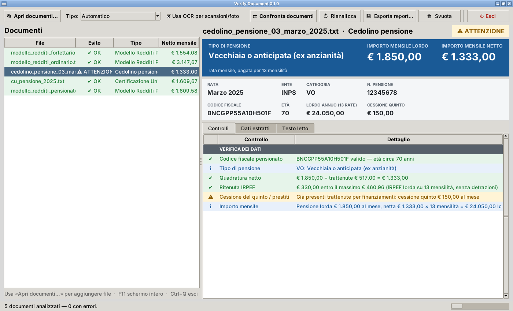
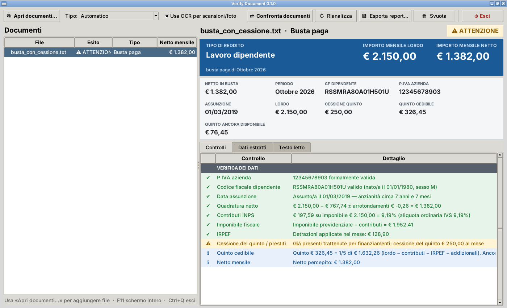
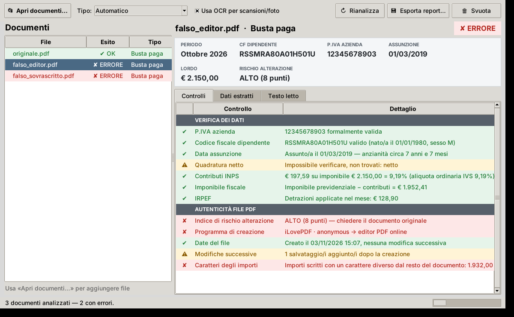
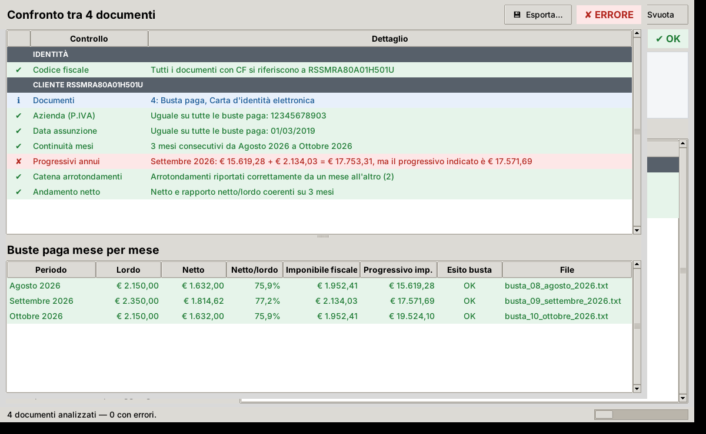
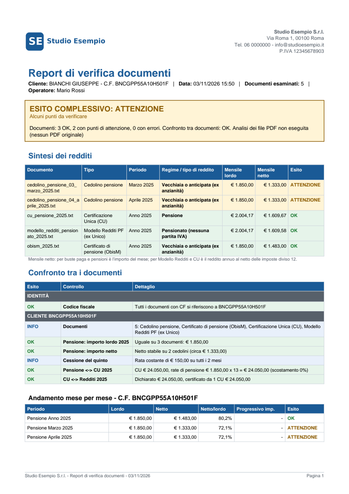
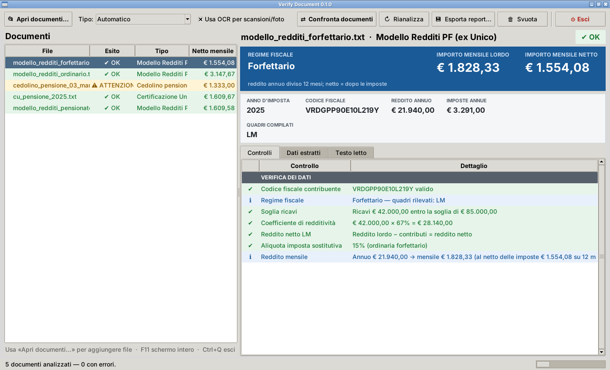

# Verify Document

Programma Python **locale** (nessun dato inviato su internet) che legge e verifica:

| Documento | Cosa estrae | Cosa controlla |
|---|---|---|
| **Busta paga** | P.IVA azienda, CF dipendente, data assunzione, periodo, competenze, trattenute, netto, imponibili, contributi, IRPEF | P.IVA e CF validi (cifra di controllo), netto = competenze − trattenute ± arrotondamenti, aliquota INPS (9,19% / 9,49% / 5,84%), imponibile fiscale = previdenziale − contributi, IRPEF netta ≤ lorda, assunzione coerente con periodo ed età |
| **Modello Redditi PF (ex Unico)** | Quadri compilati, regime fiscale, redditi dei quadri, imponibile, imposte, ritenute, acconti, cedolare secca, addizionali | Regime (forfettario, semplificato, ordinario, professionista, dipendente), reddito **mensile** lordo e netto; **catena del quadro RN** (complessivo = somma dei quadri, imponibile = complessivo − deduzioni, imposta lorda = IRPEF a scaglioni dell'anno, netta = lorda − detrazioni, saldo = netta − ritenute − acconti); quadro RE (compensi − spese) e RG (ricavi − costi); cedolare 10/21/26%; addizionali entro i limiti; forfettario: soglia 85.000 €, coefficiente di redditività, aliquota 5%/15% |
| **Certificazione Unica (CU)** | Sostituto d'imposta, dipendente, anno, redditi (punti 1-3), giorni, data inizio rapporto, ritenute IRPEF, addizionali, **imposta lorda, detrazioni, trattamento integrativo**, imponibile e contributi INPS — anche dalle **caselle numerate** con descrizione su più righe e importo sotto | CF e P.IVA validi, giorni, **imposta lorda = IRPEF a scaglioni**, **imposta lorda − detrazioni = ritenute**, totale detrazioni, addizionali regionale/comunale entro i limiti, trattamento integrativo, aliquota INPS, reddito ≈ imponibile INPS − contributi, reddito **mensile** lordo e netto |
| **Pensione** (cedolino INPS o di altre casse, certificato ObisM) | Pensionato, ente, categoria (VO, IO, SO, AS…), numero pensione, rata, lordo, IRPEF, addizionali, **cessione del quinto, prestiti, pignoramenti**, netto | CF valido ed età coerente con la categoria, netto = lordo − trattenute, IRPEF del mese entro il massimo possibile, prestazioni assistenziali (assegno sociale, invalidità civile) segnalate, importo mensile e annuo (13 mensilità) |
| **Estratto contributivo** (INPS, dipendenti pubblici ex INPDAP, Gestione separata) | Periodi dal/al, tipo di contribuzione, contributi (settimane, mesi, giorni), retribuzione, datore | **Somma dei contributi** e **anzianità contributiva** (max 52 settimane l'anno: i periodi sovrapposti non contano due volte), periodi sovrapposti e scoperti, contributi superiori alla durata del periodo, totale del documento = somma delle righe, anni mancanti a pensione anticipata e di vecchiaia |
| **Documento d'identità** (CIE, carta, patente, passaporto, tessera sanitaria) | Cognome, nome, nascita, sesso, numero, rilascio, scadenza, CF | CF valido e coerente con cognome/nome/data/sesso, documento scaduto o in scadenza |

Per i **PDF** viene inoltre esaminato il file stesso alla ricerca di **segni di alterazione** (vedi sotto).

Formati: PDF con testo (generati dai software paghe/Entratel), PDF scansionati e immagini (con OCR opzionale), file `.txt`.

## Installazione

Linux / macOS:

```bash
python -m venv .venv
source .venv/bin/activate
pip install -r requirements.txt
```

Windows (PowerShell / terminale di VS Code):

```powershell
python -m venv .venv
Set-ExecutionPolicy -Scope Process -ExecutionPolicy RemoteSigned
.\.venv\Scripts\Activate.ps1
pip install -r requirements.txt
```

### OCR: scansioni e foto

Le buste paga e i documenti **scansionati o fotografati** (PDF fatti di immagini, JPG, PNG) si leggono con
l'OCR **Tesseract**:

- **programma .exe**: Tesseract con la lingua italiana è **già incluso**, non serve installare nulla;
- **da Python**: installare Tesseract da <https://github.com/UB-Mannheim/tesseract/wiki>
  (durante l'installazione selezionare la lingua **Italian**). Il programma lo trova da solo anche se non è nel PATH.

Prima dell'OCR l'immagine viene **ripulita**: rotazione (pagine girate), raddrizzamento (pagine storte),
ingrandimento a ~300 DPI, sfondo uniforme (ombre, carta grigia), bianco e nero e **rimozione delle linee
delle tabelle**. Vengono fatte più letture e quella principale è integrata dove ha lasciato vuoti.

**Etichette e valori in colonna**: in molti cedolini il valore sta **sotto** l'etichetta
(es. `TOTALE TRATTENUTE` e sotto `517,74`). Il programma usa la **posizione** delle parole sulla pagina
(sia nei PDF con testo sia nelle scansioni) per prendere il valore della cella giusta, e riconosce
anche etichette lette con qualche lettera sbagliata (es. «METTO DEL MESE»).

La barra in basso dell'interfaccia indica se l'OCR è attivo. Se non lo è, il comando
`python -m verify_document.diagnosi` spiega cosa manca (libreria pytesseract, Tesseract, lingua italiana). Gli errori tipici dell'OCR sui numeri
(O al posto di 0, l al posto di 1, spazi dentro gli importi) vengono corretti automaticamente.
Per i documenti scansionati i controlli di autenticità del file sono limitati: se possibile chiedere il PDF originale.

## Sintesi: regime e importo mensile in evidenza

Per ogni documento di reddito il programma mostra in alto, a caratteri grandi:

| Documento | Cosa evidenzia |
|---|---|
| Modello Redditi PF | **Regime fiscale** (forfettario, semplificato, ordinario, professionista, dipendente, **pensionato**…) e **reddito mensile lordo e netto** |
| CU | Tipo di reddito (lavoro dipendente / pensione) e reddito mensile lordo e netto |
| Cedolino pensione / ObisM | Tipo di pensione e rata mensile lorda e netta |
| Busta paga | Lordo e netto del mese |

Il netto mensile compare anche nell'elenco dei documenti, nella stampa da riga di comando e nel report esportato.



## Ricalcolo delle voci della busta paga

Molti cedolini (es. Zucchetti) riportano per ogni voce gli elementi del calcolo. Il programma li **rifà tutti**:

| Voce | Calcolo |
|---|---|
| `Retribuzione edili  11,89171  56,00000 ORE  665,94` | tariffa × quantità |
| `Contributo IVS  859,00  9,19000%  78,95` | base × aliquota (tollerando la base INPS arrotondata all'euro) |

Un importo ritoccato senza rifare il calcolo risulta **errore**. I contributi IVS del dipendente vengono
**sommati su tutte le pagine** (buste con una pagina per cantiere o reparto); gli importi tra parentesi
(quota dell'azienda) sono esclusi. Anche le intestazioni in cui lo spazio viene letto come "s"
(«TOTALEsCOMPETENZE», «NETTOsDELsMESE») vengono riconosciute, e il nome del dipendente viene trovato
grazie al codice fiscale anche quando non ha un'etichetta accanto.

## Cessione del quinto, deleghe e pignoramenti

Su **buste paga** e **cedolini della pensione** il programma individua le trattenute per
cessione del quinto, delegazione di pagamento (prestito con delega) e pignoramento, e calcola
il **quinto cedibile** e quanto è **ancora disponibile** per un nuovo finanziamento:

| Controllo | Regola (DPR 180/1950) |
|---|---|
| Rata di cessione | al massimo 1/5 del netto (lordo − contributi − IRPEF − addizionali) |
| Cessione + delegazione | al massimo 2/5 |
| Cessione + pignoramento | al massimo metà del netto |
| Confronto tra mesi | la rata è fissa: rate diverse, cessioni iniziate o estinte vengono segnalate |

Una rata oltre i limiti di legge è segnalata come **errore** (documento da verificare).
Per le pensioni la quota cedibile deve inoltre lasciare almeno il trattamento minimo INPS.



## Controllo autenticità dei PDF

Oltre a verificare che i calcoli tornino, il programma esamina il file PDF e assegna un
**indice di rischio di alterazione** (BASSO / MEDIO / ALTO):

| Indizio | Punti |
|---|---|
| Creato o salvato con un editor PDF online (iLovePDF, Smallpdf, Sejda, Canva…) | 3 |
| Importo scritto con un carattere diverso dal resto del documento | 3 |
| Testo scritto sopra altro testo (es. «6» coperto da «9») | 3 |
| Annotazioni/caselle di testo aggiunte sopra la pagina | 3 |
| File creato prima del periodo a cui si riferisce | 3 |
| Programma di modifica PDF (Acrobat Pro, Foxit, PDF-XChange…) o Word/LibreOffice | 2 |
| Data di modifica diversa dalla creazione / salvataggi successivi | 2 |
| Stampante virtuale PDF, metadati assenti, campi compilabili, solo scansione | 1 |
| Importo isolato in grassetto/corsivo (spesso normale per il netto) | 1 |

0 punti = basso, 1–2 = medio, 3 o più = alto (chiedere il documento originale).



> Nessun controllo automatico può **certificare** l'originalità: lo strumento segnala anomalie
> che un operatore deve valutare. Un indice basso non garantisce che il documento sia autentico.

## Fascicolo cliente

Sotto l'elenco dei documenti il riquadro **Fascicolo cliente** mostra, per ogni cliente (codice fiscale):

- i documenti presenti (documento d'identità, buste paga con il periodo, CU, Modello Redditi, pensione)
- l'esito dei **controlli incrociati**, eseguiti automaticamente appena ci sono almeno 2 documenti
- **cosa aggiungere** per fare altri controlli, ad esempio «CU 2026 (redditi 2025): per verificare reddito
  annuo e IRPEF delle buste paga 2025» oppure «Buste paga 2025 (ideale dicembre): per verificare la CU»

**⇄ Confronto completo** apre il dettaglio di tutti i controlli incrociati.

## Confronto tra documenti dello stesso cliente

Caricando più documenti (es. 3 buste paga consecutive + carta d'identità + Modello Redditi) e premendo
**⇄ Confronta documenti** (o con `--confronta` da riga di comando) il programma verifica:

| Controllo | Cosa scopre |
|---|---|
| Stesso codice fiscale su tutti i documenti | Documenti di persone diverse mescolati |
| Stessa P.IVA e stessa data di assunzione | Busta paga presa da un'altra azienda o alterata |
| **Progressivi annui**: progressivo del mese = progressivo precedente + imponibile del mese | Busta gonfiata ricalcolando tutto in modo coerente (da sola sembra regolare!) |
| Arrotondamento "precedente" = arrotondamento "attuale" del mese prima | Netto ritoccato |
| Rapporto netto/lordo e netto simili agli altri mesi | Netto alterato senza ricalcolare il lordo |
| Mesi doppi (con netto diverso) o mancanti | Due versioni dello stesso cedolino |
| Buste paga ↔ **CU** dello stesso anno: reddito e IRPEF = progressivi di dicembre, stesso datore e data di assunzione | CU o buste paga alterate |
| **CU ↔ Modello Redditi**: reddito da lavoro dipendente e pensione dichiarato = somma delle CU | Reddito dichiarato gonfiato o CU mancante |
| **Pensione**: stessa categoria per lo stesso numero di pensione, rata lorda costante nell'anno, netto stabile | Cedolino alterato |
| **Pensione ↔ CU**: reddito di pensione della CU = rata lorda × 13 | CU o cedolini non compatibili |
| Buste paga ↔ reddito da lavoro dipendente del Modello Redditi dello stesso anno | Redditi dichiarati diversi da quelli delle buste |
| Più anni di Modello Redditi | Cambi di regime, variazioni di reddito molto forti |



Prova con i documenti di esempio:

```bash
python -m verify_document esempi/confronto/*.txt --confronta
python -m verify_document esempi/pensionato/*.txt --confronta
```

## Home: scelta del settore

All'avvio si apre la **Home** con il nome del programma, i pulsanti dei settori
(🏢 **Privato**, 👴 **Pensionato**, 🏛 **Statale**, 💼 **Autonomo**), ⚙ Impostazioni ed Esci.

Scelto il settore, in alto compaiono i **documenti da chiedere al cliente**:

| Settore | Richiesti | Facoltativi |
|---|---|---|
| Privato | 3 buste paga, CU, documento d'identità, estratto contributivo | Unico/Redditi |
| Pensionato | cedolino pensione, ObisM, CU, documento d'identità, estratto contributivo | Unico/Redditi |
| Statale | 3 cedolini NoiPA, CU, documento d'identità, estratto contributivo | Unico/Redditi |
| Autonomo | Unico/Redditi (ultimi 2 anni), documento d'identità, estratto contributivo | CU |

Ogni documento è un pulsante: clic → si sceglie il file, analizzato con il tipo giusto.
Il colore indica cosa c'è e cosa manca: **verde** caricato, **giallo** ne servono altri (es. «Buste paga 2 di 3»),
**rosso** manca, grigio facoltativo; sotto, il riepilogo «mancano: …».
«🏠 Home» o «Cambia settore» tornano alla Home (con la scelta di iniziare un nuovo cliente).

## Schermi piccoli e zoom di Windows

Le finestre si adattano allo schermo: con lo zoom di Windows (es. 150% su un portatile da 14") colonne,
finestre e spazi crescono insieme ai caratteri; le file di pulsanti vanno a capo se non c'è spazio; le
finestre secondarie non superano mai lo schermo. Sotto 1500×880 punti effettivi (es. 1366×768, oppure
1920×1080 al 150%) si attiva la **modalità compatta**: caratteri un po' più piccoli e testi dei pulsanti
più brevi. Per provarla o escluderla: variabile `VERIFY_DOCUMENT_COMPATTO=1` (o `0`).

## Conteggio estinzione

**🧮 Conteggio estinzione**: inserisci rata, decorrenza, scadenza (oppure rate totali / residue) e, se noti,
TAN o importo finanziato e costi iniziali. Il calcolo sommario (ammortamento alla francese) restituisce
rate pagate e residue, debito residuo lordo, **capitale residuo**, interessi non dovuti, **indennizzo**
(1% o 0,5%, art. 125-sexies TUB, non dovuto sotto 10.000 €), costi da restituire in proporzione e
**totale per estinguere**; segnala rate scadute ma non pagate e quando la cessione è **rinnovabile**
(40% della durata). È una stima: fa fede il conteggio estintivo della finanziaria.

## Dati personali oscurati in ciò che esce dal PC

Sullo schermo i dati restano visibili. **Report PDF, esportazioni .txt/.json e report del confronto**
sono invece creati con i dati personali oscurati: nome → iniziali, codice fiscale `XXXXXX00X00X000X`,
data e luogo di nascita, numeri di documento/pensione, matricola e IBAN. Gli importi restano.
Si disattiva in **⚙ Impostazioni** (o `--dati-in-chiaro` da riga di comando).
Nella scheda «Testo letto» c'è **📋 Copia testo anonimizzato** per chiedere assistenza.

## Archivio documenti

Quando apri un documento da qualsiasi cartella (es. la cartella delle **scansioni**), il programma ne salva
una **copia nell'archivio**: una cartella per cliente (**COGNOME NOME**) e dentro una sottocartella per prodotto:

```
documenti/
  ROSSI MARIO/
    Buste paga/
      Busta paga - Ottobre 2026 - [Untitled]_2023012715060859.pdf
    CU/
      CU - Anno 2025 - scansione_12.pdf
    Estratti contributivi/
    Documenti identità/
  BIANCHI GIUSEPPE/
    Cedolini pensione/
    ObisM/
```

La cartella è legata al codice fiscale (file nascosto `.codice_fiscale`): se il nome viene letto in modo
diverso si usa la stessa cartella; un omonimo con codice fiscale diverso riceve il CF tra parentesi.

- l'originale non viene mai toccato; lo stesso file non viene copiato due volte
- **🗂 Archivio**: elenco per cliente, ordinabile per **periodo** del documento, data o nome (clic sull'intestazione),
  ricerca, doppio clic per riaprire, **Elimina** (anche un cliente intero) → i file vanno nel **Cestino**
- la copia si può disattivare con «Salva copia nell'archivio»; nell'elenco principale tasto destro
  → «Elimina la copia dall'archivio», tasto Canc → rimuovi dall'elenco
- cartella dell'archivio: **⚙ Impostazioni** (predefinita: `documenti` nel progetto, oppure
  `Documenti\Verify Document\documenti` per il .exe)

**Ordine per data**: nell'elenco dei documenti la colonna **Data** è il periodo del documento (mese della busta
paga, anno di CU e Modello Redditi); clic sull'intestazione di una colonna per ordinare, di nuovo per invertire.
In **⚙ Impostazioni** si può indicare la **cartella da cui aprire i documenti** (es. le scansioni).
Nella finestra «Scegli i documenti» di Windows: vista **Dettagli** → clic su **Ultima modifica**.

## Report PDF

Il pulsante **📄 Report PDF** (o `--pdf report.pdf` da riga di comando) crea un PDF da consegnare
al cliente o alla finanziaria con:

1. intestazione con **logo e dati dello studio** (da **⚙ Impostazioni**, salvati una volta sola)
2. cliente (nome e codice fiscale), data, operatore
3. **esito complessivo** e rischio di alterazione dei file
4. **sintesi dei redditi**: per ogni documento regime/tipo di reddito e importo mensile lordo e netto
5. **confronto tra i documenti** e andamento mese per mese (se i documenti sono più di uno)
6. dettaglio di ogni documento con dati e controlli
7. nota sui limiti dello strumento, spazio per la firma, numeri di pagina

Esempio completo: [docs/report_esempio.pdf](docs/report_esempio.pdf)



```bash
python -m verify_document esempi/pensionato/*.txt --pdf report.pdf
```

Le impostazioni dello studio sono salvate in `~/.verify_document/impostazioni.json`
(Windows: `C:\Users\<nome>\.verify_document\impostazioni.json`).

## Interfaccia grafica



Doppio clic su **`Avvia Verify Document.bat`** (Windows), oppure dal terminale:

```powershell
python -m verify_document.gui
```

- **Apri documenti…**: seleziona uno o più PDF, immagini o .txt (analizzati in parallelo)
- in alto il **riepilogo**: netto/CF/P.IVA/assunzione per la busta paga, regime e reddito mensile per il Modello Redditi
- schede **Controlli** (✔ verde, ⚠ giallo, ✘ rosso; doppio clic per leggere il dettaglio completo),
  **Dati estratti** e **Testo letto** (per capire cosa non è stato trovato)
- **📄 Report PDF** e **💾 Esporta ▾** (PDF, .txt, .json); **⚙ Impostazioni** per logo e dati dello studio
- **Rianalizza** dopo aver cambiato il tipo di documento
- per trascinare i file nella finestra: `pip install tkinterdnd2`
- si apre a tutto schermo; **F11** schermo intero senza bordi, **Esc** per tornare indietro
- **⏻ Esci** (o **Ctrl+Q**, o la X della finestra) chiede conferma se ci sono documenti analizzati

## Programma per Windows (.exe)

Il programma si può distribuire come **VerifyDocument.exe**, senza bisogno di installare Python.
**A ogni modifica del codice il .exe va ricreato**, in uno di questi due modi:

**1. Automatico su GitHub** – a ogni modifica caricata, GitHub crea il .exe su un computer Windows,
esegue i test e l'autotest e lo mette a disposizione nella pagina **Actions** del repository
(apri l'ultima esecuzione di "Crea exe Windows" → sezione **Artifacts** → `VerifyDocument-<versione>-windows`).
Per una versione da distribuire si crea un tag, ad esempio `v0.2.0`: lo zip viene allegato a una **Release**.

**2. Sul tuo PC** – doppio clic su **`crea_exe.bat`** (installa PyInstaller, prepara l'OCR, esegue i test,
crea il programma, lo verifica e prepara lo zip). Per includere l'OCR serve Tesseract installato sul PC
(`scripts/prepara_tesseract.py` lo copia nel programma insieme alla lingua italiana):

```
dist\VerifyDocument\VerifyDocument.exe            ← il programma
dist\VerifyDocument-<versione>-windows.zip         ← da consegnare ai clienti
```

Il programma è una **cartella** (`VerifyDocument.exe` + cartella `_internal`): va copiata/consegnata intera,
ad esempio come zip. Per verificare che contenga tutto: `VerifyDocument.exe --autotest`
(il risultato è in `%TEMP%\verify_document_autotest.log`).

> Windows SmartScreen può mostrare "Windows ha protetto il PC" perché il programma non è firmato:
> *Ulteriori informazioni → Esegui comunque*. Per la vendita conviene un certificato di firma del codice.

## Uso da riga di comando

```bash
python -m verify_document esempi/busta_paga_esempio.txt
python -m verify_document documenti/cedolino.pdf --tipo busta
python -m verify_document documenti/*.pdf --json > report.json
python -m verify_document documenti/cedolino.pdf --testo     # mostra il testo letto (per tarare le etichette)
```

Codice di uscita: `0` tutto ok, `1` almeno un controllo in ERRORE, `2` file non leggibile.

## Test

```bash
pip install -r requirements-dev.txt     # pypdf, per generare i PDF falsificati di prova
python -m unittest discover -s tests -v
```

## Struttura

```
verify_document/
  estrazione.py       testo e posizione delle parole da PDF / OCR
  preelaborazione.py  pulizia delle immagini prima dell'OCR
  layout.py           abbinamento etichetta → valore in base alla posizione (colonne)
  validators.py       codice fiscale, partita IVA, importi, date
  busta_paga.py       analisi cedolino
  modello_redditi.py  analisi Modello Redditi PF
  pensione.py         analisi cedolino pensione e certificato ObisM
  estratto_contributivo.py  estratto conto contributivo: periodi, somma contributi, anzianità
  estinzione.py       conteggio sommario di estinzione anticipata
  settori.py          settori (Privato, Pensionato, Statale, Autonomo) e documenti da chiedere
  impegni.py          cessione del quinto, deleghe, pignoramenti, quinto cedibile
  voci.py             ricalcolo delle voci (tariffa × quantità, base × aliquota) e contributi IVS
  anonimizza.py       testo senza dati personali da inviare per l'assistenza
  report_pdf.py       report PDF con logo e dati dello studio
  archivio.py         archivio dei documenti per cliente (copia, elenco, eliminazione nel Cestino)
  impostazioni.py     dati dello studio (impostazioni.json)
  cu.py               analisi Certificazione Unica (scaglioni IRPEF per anno in SCAGLIONI_IRPEF)
  anagrafica.py       analisi documenti d'identità
  autenticita.py      esame del file PDF (segni di alterazione)
  confronto.py        confronto tra più documenti dello stesso cliente
  report.py           esiti dei controlli
  cli.py              riga di comando
  gui.py              interfaccia grafica (Tkinter)
  autotest.py         verifica che il programma (.exe) contenga tutto il necessario
avvia_gui.py          avvio del programma (anche per il .exe)
VerifyDocument.spec   configurazione di PyInstaller
crea_exe.bat          crea il .exe su Windows (doppio clic)
scripts/              prepara_tesseract.py: copia Tesseract (OCR) da includere nel .exe
assets/               icona del programma
.github/workflows/    creazione automatica del .exe su GitHub
esempi/               documenti FITTIZI di prova (esempi/confronto: 3 buste + carta d'identità;
                      esempi/pensionato: cedolini, ObisM, CU INPS e Modello Redditi di un pensionato)
tests/                test automatici
```

## Limiti attuali (da sapere prima di vendere)

- Ogni software paghe (Zucchetti, TeamSystem, INAZ, ADP…) impagina il cedolino in modo diverso:
  le diciture cercate sono nelle liste `ETICHETTE` dei moduli e vanno tarate su **documenti reali anonimizzati**.
- La numerazione dei righi del Modello Redditi e dei punti della CU può cambiare: la ricerca avviene per descrizione.
- Gli scaglioni IRPEF sono in `cu.py` (`SCAGLIONI_IRPEF`): vanno aggiornati a ogni legge di bilancio.
- Il programma segnala incongruenze, **non sostituisce** la verifica di un professionista.

> ⚠ Non salvare mai documenti reali dei clienti nel repository (le cartelle `documenti/` e `clienti/` sono già escluse in `.gitignore`).
